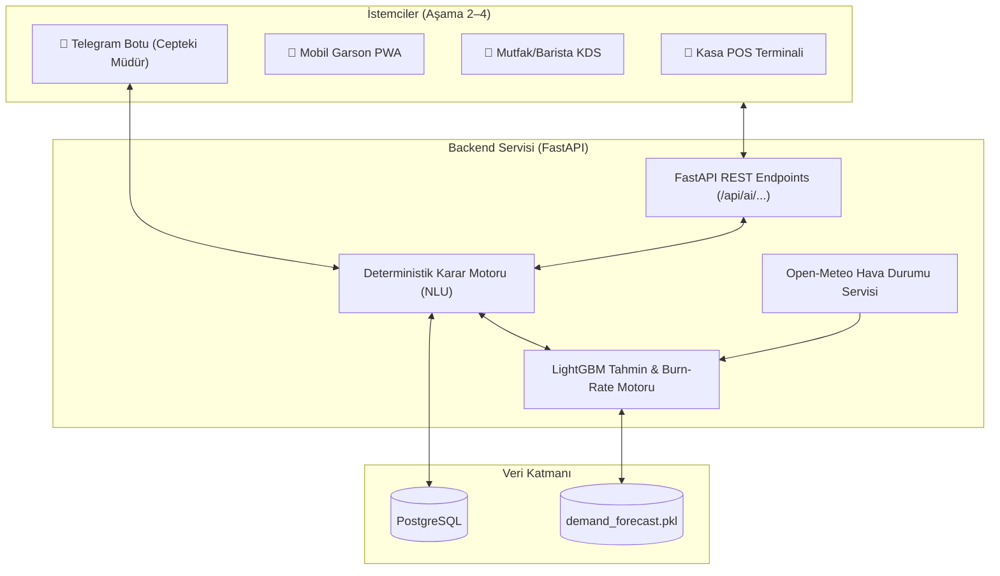

# ☕ CafeERP: Yapay Zeka Destekli Yeni Nesil Kafe İşletim ve Karar Destek Sistemi

> **CafeERP**, modern 3. nesil specialty kahve dükkanları ile geleneksel Türk kafe/kıraathane dinamiklerini birleştiren, makine öğrenmesi destekli akıllı bir kafe yönetim ve karar destek platformudur.

---

## 🌟 Öne Çıkan Özellikler

- **🧠 Makine Öğrenmesi ile Talep & Ciro Tahmini:** LightGBM regresyon modeli, geçmiş 6 aylık saatlik veriyi ve canlı hava durumu koşullarını harmanlayarak günün pik saatlerini ve beklenen satış hacmini öngörür.
- **🥛 Stok ve Reçete Motoru:** Hazırlık başladığında SQL reçetesinden gerçek stok tüketir; giriş, iade ve zayiatı hareket defterinde tutar. Ayrı tükenme simülasyonu, günün kalan saatleri ve SQL reçeteleriyle sınırlı kapsamda tahmin üretir.
- **🌤️ Canlı Hava Durumu Entegrasyonu:** Open-Meteo REST API ile sıfır konfigürasyon ve ücretsiz olarak kafe bölgesinin sıcaklık ve yağış durumunu çeker.
- **📱 Cepteki Müdür (Telegram Bot Asistanı):** Kafe sahibine sabah brifingi sunar, klavye butonları ve serbest Türkçe NLU motoru ile anlık ciro, yoğunluk ve stok sorgulama imkanı sağlar.
- **⚡ Halüsinasyonsuz Karar Motoru (LLM-less NLU):** Finansal ciro ve stok hesaplamalarında harici LLM maliyeti ve halüsinasyon riski olmadan %100 matematiksel doğrulukla çalışan Türkçe kural motoru.
- **🍽️ Dokunmatik POS & Mobil Garson Terminali (Aşama 2–4):** Tablet üzerinden hızlı kasa satışı, masa krokisi, mutfak ekranı (KDS) ve garsonun masada cep telefonundan sipariş alabilmesi.

---

## 🏗️ Mimari ve Teknoloji Yığını



- **Backend:** Python 3.12, FastAPI, Uvicorn, Pydantic v2
- **Yapay Zeka & Veri Bilimi:** LightGBM, Pandas, Scikit-learn, Joblib
- **Veritabanı:** PostgreSQL (örnek SQLite verisinden aktarılmış 37.000+ sipariş)
- **Frontend:** Next.js 16, Tailwind CSS, shadcn/ui
- **Harici API'ler:** Open-Meteo API, Telegram Bot API

---

## 📁 Proje Dizin Yapısı

Detaylı dosya ve kod haritası için **[CODEX.md](CODEX.md)** belgesine bakınız.

```
cafe_erp/
├── CODEX.md                     # Yapay zeka ajanları ve Codex için ana referans
├── AGENTS.md                    # Multi-agent sistemler için rehber
├── requirements.txt             # Proje Python bağımlılıkları
├── requirements.lock            # Docker için sabitlenmiş bağımlılıklar
├── Dockerfile, compose.yaml     # Konteyner imajı ve servisleri
├── .devcontainer/               # VS Code geliştirme konteyneri
├── backend/
│   └── app/
│       ├── main.py              # FastAPI sunucu giriş noktası
│       ├── api/ai_routes.py     # AI REST rotaları
│       └── ai/                  # Tahmin modeli, karar motoru ve Telegram botu
├── data/
│   ├── sample_cafe.db           # Salt okunur eski örnek veri kaynağı
│   └── generator/               # Eski örnek veri üreteci
├── migrations/                  # Alembic PostgreSQL şema geçişleri
├── scripts/import_sqlite.py     # Eski örnek veriyi PostgreSQL'e aktarır
├── tests/                       # Çekirdek ve API entegrasyon testleri
└── docs/                        # Mimari, geliştirme notları ve görseller
```

---

## 🚀 Hızlı Başlangıç (Quickstart)

### Docker ile başlatma

Docker Desktop açıkken proje kökünde:

```powershell
docker compose up -d --wait db
docker compose build api
docker compose run --rm api python -m alembic upgrade head
docker compose run --rm api python scripts/import_sqlite.py
docker compose run --rm api python scripts/import_recipes.py
docker compose run --rm api python scripts/create_admin.py
docker compose up -d --wait api
```

İlk kullanımdan önce `.env` dosyasında `POSTGRES_PASSWORD` tanımlanmalıdır.
Şema geçişi ve örnek veri aktarımı ilk kurulum içindir; aktarım dolu hedefe yazmaz.

API: http://localhost:8000 — Swagger: http://localhost:8000/docs

POS ve mutfak arayüzü için `docker compose up -d --build --wait frontend` çalıştırın.
Arayüz: http://localhost:3000. Ayrıntılar: [Frontend kılavuzu](frontend/README.md).
İlk yönetici parolası terminalde belirlenir; örnek PIN'ler girişte kullanılmaz.
Personel ve rol kuralları: [Erişim kılavuzu](docs/AUTH.md).

Kapatmak için `docker compose down` kullanın. Dev Container, Telegram ve
veri saklama ayrıntıları: [Docker kılavuzu](docs/DOCKER.md).

Uygulama kodu `backend/`, örnek veriler `data/`, testler `tests/` altındadır.

### 1. Kurulum
```bash
git clone <repo-url>
cd cafe_erp
pip install -r requirements.txt
```

### 2. Ortam Değişkenleri (`.env`)
Kök dizinde `.env` dosyasını oluşturun:
```env
TELEGRAM_BOT_TOKEN="your_bot_token_here"
TELEGRAM_ALLOWED_USER_IDS="123456789"
POSTGRES_PASSWORD="yerel-guclu-bir-parola"
CAFE_LATITUDE=37.7647
CAFE_LONGITUDE=30.5567
```

`TELEGRAM_ALLOWED_USER_IDS`, virgülle ayrılmış Telegram kullanıcı kimlikleridir. Bot yalnızca bu kullanıcıların özel sohbetlerine yanıt verir; liste boşsa başlamaz. Konum belirtilmezse Kadıköy koordinatları kullanılır.

### 3. FastAPI Backend Servisini Başlatma
```bash
python backend/app/main.py
```
Sunucu `http://127.0.0.1:8000` adresinde ayağa kalkacaktır. Etkileşimli Swagger API dokümantasyonu: `http://127.0.0.1:8000/docs`

### 4. Telegram Botunu Başlatma
```bash
python backend/app/ai/telegram_bot.py
```

### 5. Modelleri ve Veriyi Yeniden Üretme (Opsiyonel)
```bash
# LightGBM tahmin modelini eğitme
python backend/app/ai/train_forecast.py
```

---

## 🗺️ Geliştirme Yol Haritası (Roadmap)

- [x] **Temel altyapı:** Örnek veri, AI karar destek servisleri, Telegram, Docker/Dev Container, PostgreSQL/Alembic ve menü/masa listeleme API'leri.
- [x] **Aşama 1 — Tamamlandı:** Adisyon, kalem, hazırlık durumu ve ödeme backend'i; güvenli tekrar istekler ve doğru satış raporlama.
- [x] **Aşama 2 — Tamamlandı:** Tek masa için uçtan uca POS ve basit mutfak ekranı.
- [x] **Aşama 3 — Backend tamamlandı:** SQL reçeteleri, hazırlıkta gerçek stok tüketimi ve hareket defteri.
- [ ] **Aşama 4 (devam ediyor):** 4.1 personel girişi/roller ve personel yönetimi uygulandı. Sıradaki 4.2 stok/reçete yönetim ekranları; ardından yönetici özeti, mobil garson/canlı KDS ve gelişmiş ödeme.
- [ ] **Aşama 5:** Yedekleme, mutabakat ve pilot kafe doğrulaması.

Ayrıntılı kapsam ve her aşamanın çıkış ölçütleri: [güncel yol haritası](docs/ROADMAP.md).

---

## 📄 Detaylı Dokümantasyon

Çekirdek doğruluk düzeltmeleri, test komutu ve güncel sınırlamalar için [docs/DEVELOPMENT.md](docs/DEVELOPMENT.md) dosyasına bakınız.

- **[CODEX.md](CODEX.md):** Codex ve otonom kodlama ajanları için eksiksiz bilgi bankası.
- **[docs/ARCHITECTURE.md](docs/ARCHITECTURE.md):** Sistem mimarisi ve PostgreSQL şeması.
- **[docs/MODULES_AND_FLOWS.md](docs/MODULES_AND_FLOWS.md):** Operasyonel akışlar (POS, KDS, Garson).
- **[docs/FISCAL_AND_MVP_STRATEGY.md](docs/FISCAL_AND_MVP_STRATEGY.md):** Türkiye ÖKC ve mali mevzuat yaklaşımı.
- **[docs/ROADMAP.md](docs/ROADMAP.md):** Aşama bazlı geliştirme planı.
- **[docs/ORDERS.md](docs/ORDERS.md):** Adisyon/ödeme API sözleşmesi ve güncelleme komutları.
- **[docs/STOCK.md](docs/STOCK.md):** Reçete ve stok hareketi politikası, API ve kurulum.
- **[docs/REVIEW_2026-10-31.md](docs/REVIEW_2026-10-31.md):** Kod incelemesi, düzeltilenler ve kalan işler.
