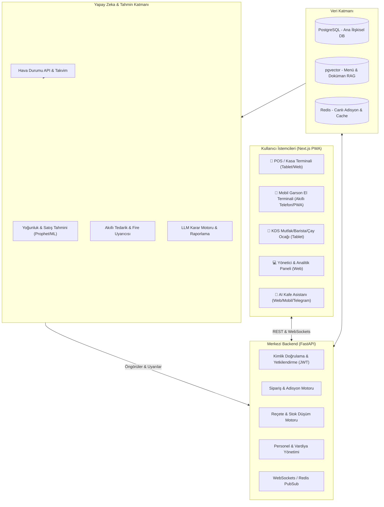

# 🏗️ CafeERP - Sistem ve Veritabanı Mimarisi

Bu dokümanda CafeERP'nin teknik bileşenleri, veri akışları ve ilişkisel veritabanı şeması detaylandırılmıştır.

---

## 1. Genel Sistem Mimarisi

---

## 2. İlişkisel Veritabanı Şeması (PostgreSQL)

Bir kafenin sipariş, reçete ve stok döngüsünü eksiksiz yönetebilmesi için tasarlanan çekirdek tablolar:

### A. Hammaddeler ve Stok (Raw Materials & Inventory)
* `raw_materials`:
  * `id`: UUID (PK)
  * `name`: String (örn: "Espresso Çekirdeği - Blend", "Tam Yağlı Süt", "Karton Bardak 12oz")
  * `category`: String ("Kahve", "Süt", "Ambalaj", "Sos")
  * `unit`: String ("gram", "ml", "adet")
  * `current_stock`: Float (Depodaki miktar)
  * `min_alert_level`: Float (Kritik stok eşiği)
  * `cost_per_unit`: Decimal (Birim maliyet)

### B. Menü ve Varyasyonlar (Menu & Modifiers)
* `categories`:
  * `id`: UUID (PK)
  * `name`: String (örn: "Sıcak Kahveler", "Soğuk Kahveler", "Tatlılar")
  * `display_order`: Integer
* `products`:
  * `id`: UUID (PK)
  * `category_id`: UUID (FK)
  * `name`: String (örn: "Latte", "Americano", "San Sebastian")
  * `base_price`: Decimal
  * `is_active`: Boolean
* `product_variants`:
  * `id`: UUID (PK)
  * `product_id`: UUID (FK)
  * `name`: String (örn: "Small", "Medium", "Large")
  * `additional_price`: Decimal
* `product_modifiers`:
  * `id`: UUID (PK)
  * `name`: String (örn: "Yulaf Sütü", "Ekstra Shot", "Vanilya Şurubu")
  * `additional_price`: Decimal

### C. Reçeteler (Recipes / Bill of Materials)
Her ürün veya varyasyon için hammadde tüketim formülü:
* `recipes`:
  * `id`: UUID (PK)
  * `product_id`: UUID (FK)
  * `variant_id`: UUID (FK, Opsiyonel)
  * `raw_material_id`: UUID (FK)
  * `quantity_needed`: Float (örn: 18g kahve, 220ml süt)

### D. Masalar ve Siparişler (Tables & Orders)
* `dining_tables`:
  * `id`: UUID (PK)
  * `table_number`: String (örn: "Masa 1", "Bahçe 3", "Paket/Kasa")
  * `status`: Enum ("empty", "occupied", "reserved")
* `orders`:
  * `id`: UUID (PK)
  * `table_id`: UUID (FK)
  * `server_id`: UUID (FK - Siparişi alan personel)
  * `status`: Enum ("open", "preparing", "ready", "paid", "cancelled")
  * `total_amount`: Decimal
  * `payment_method`: Enum ("cash", "credit_card", "partial", "gift")
  * `created_at`: Timestamp
  * `closed_at`: Timestamp
* `order_items`:
  * `id`: UUID (PK)
  * `order_id`: UUID (FK)
  * `product_id`: UUID (FK)
  * `variant_id`: UUID (FK)
  * `quantity`: Integer
  * `unit_price`: Decimal
  * `notes`: String ("Az sıcak olsun")

---

## 3. Yapay Zeka Katmanı Entegrasyonu

1. **Zaman Serisi Tahmini (Time-Series ML):**
   * Veritabanındaki `orders` tablosundaki saatlik sipariş sayıları, dışarıdan alınan `hava durumu (sıcaklık, yağış)` ve `haftanın günü` değişkenleriyle eğitilir.
   * Çıktı: Saatlik müşteri yoğunluğu ve ürün talep tahminleri.
2. **Reçete & Stok Simülasyonu:**
   * Gelecek 3 günün tahmin edilen satış miktarları `recipes` tablosuyla çarpılarak hammadde tükeniş gün ve saatleri (Burn Rate) hesaplanır.
3. **LLM Asistanı (LangChain / Instructor):**
   * SQL sorguları yerine FastAPI endpoint'lerinden toplanan günlük metrikler LLM'e özetletilerek kafe sahibine WhatsApp / Dashboard üzerinden Türkçe aksiyon raporu olarak iletilir.
